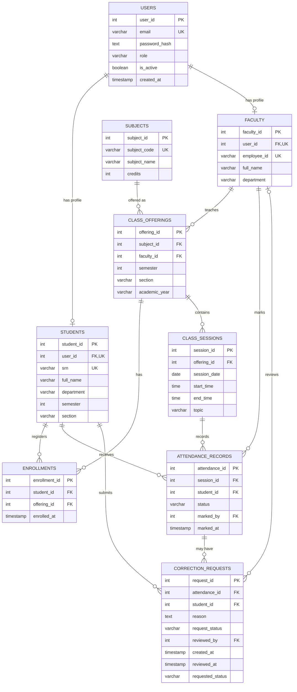

# ER diagram — College Attendance Management System

## Relational constraints

| Table | Constraint |
|---|---|
| users | Email is unique; role must be ADMIN, FACULTY or STUDENT |
| students | user_id and srn are unique; semester must be between 1 and 8 |
| faculty | user_id and employee_id are unique |
| subjects | subject_code is unique; credits must be positive |
| class_offerings | Unique combination of subject_id, semester, section and academic_year |
| enrollments | Unique combination of student_id and offering_id |
| class_sessions | end_time must be later than start_time; unique offering, date and start time |
| attendance_records | Status must be PRESENT, ABSENT or LATE; one record per session and student |
| correction_requests | Request status must be PENDING, APPROVED or REJECTED |
