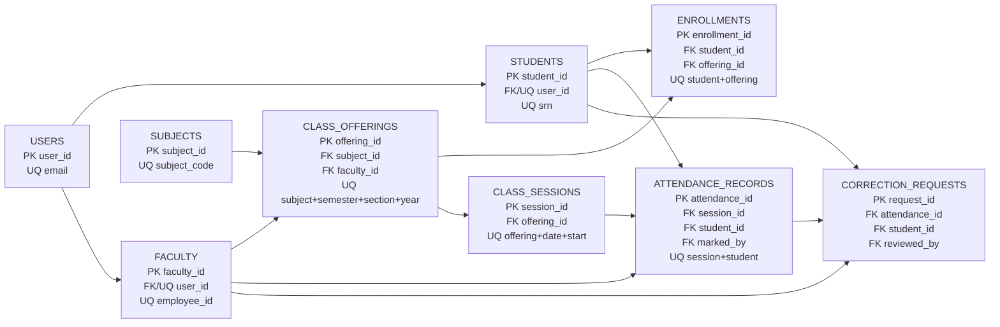

# Relational schema diagram — College Attendance Management System

**Legend:** PK = Primary Key; FK = Foreign Key; UQ = Unique constraint. Composite unique constraints are written out in the relevant table box.
