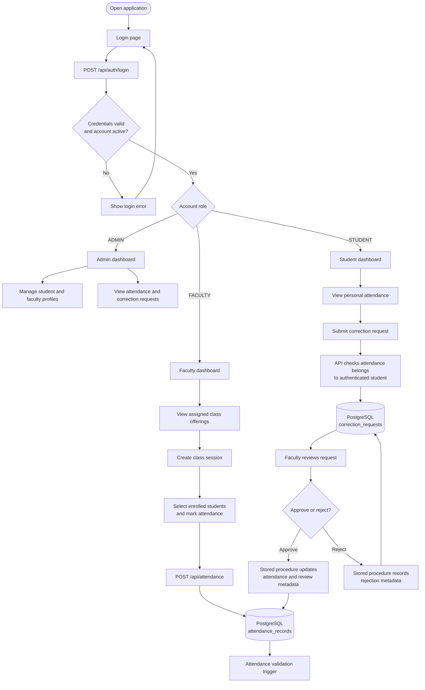
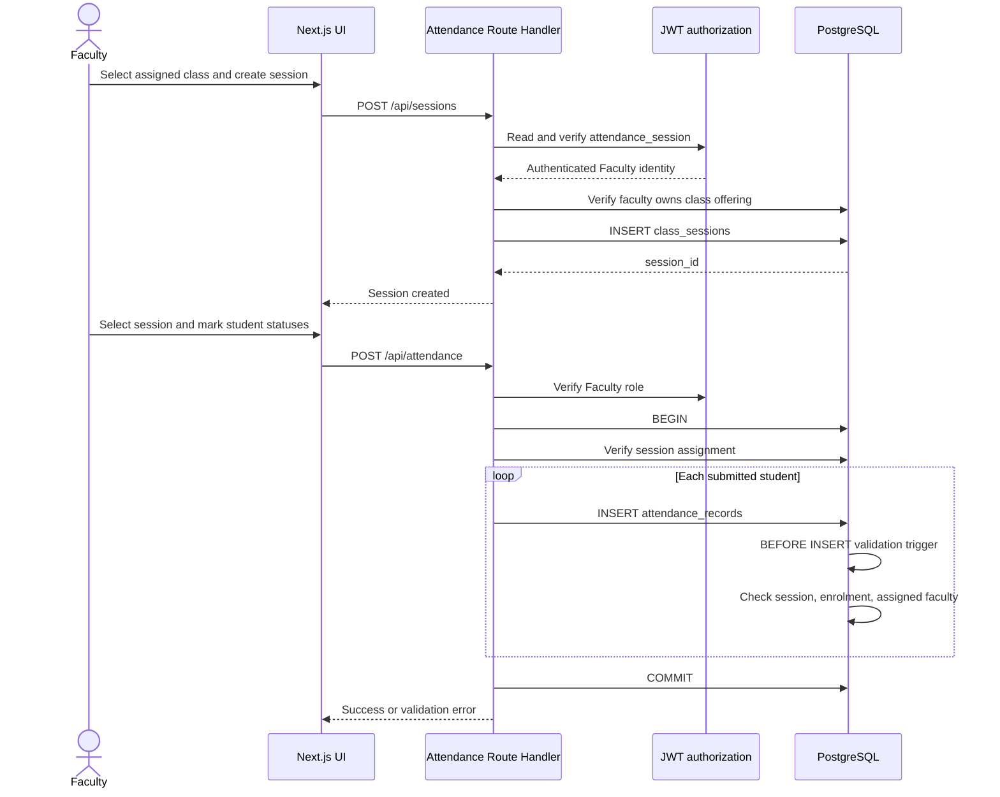
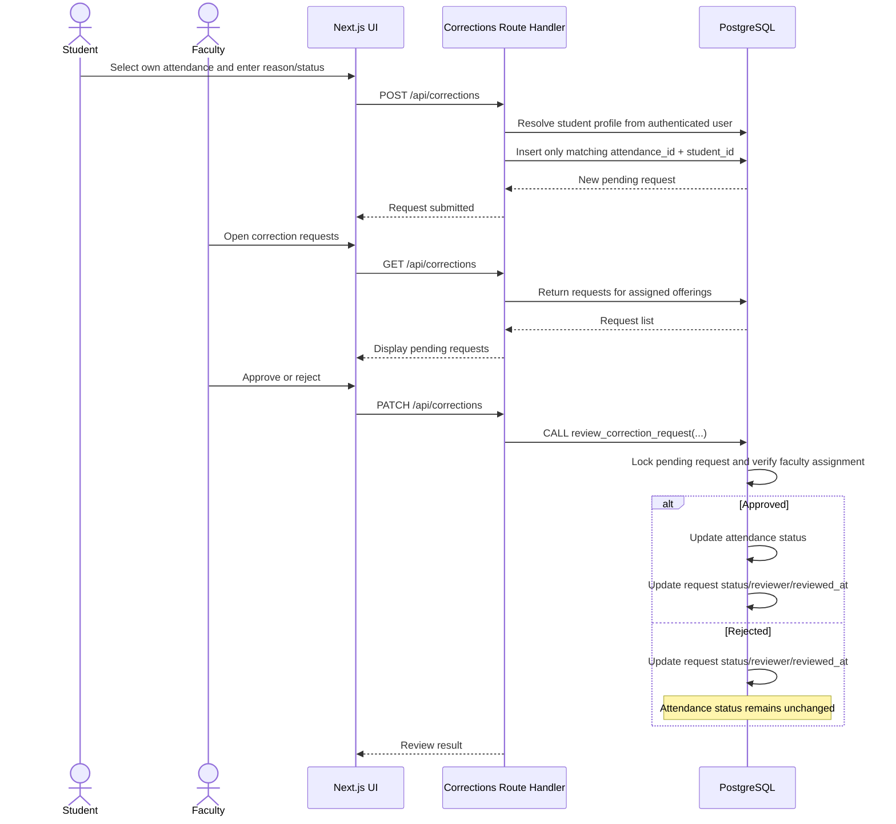

# System Workflow — College Attendance Management System

## 1. Role-based functional workflow

## 2. Attendance recording sequence

## 3. Attendance correction sequence

## 4. Role capability summary

| Capability | Admin | Faculty | Student |
|---|---:|---:|---:|
| View student records | Yes | No | No |
| Create student accounts/profiles | Yes | No | No |
| View faculty records | Yes | No | No |
| Create faculty accounts/profiles | Yes | No | No |
| View all attendance | Yes | No | No |
| View assigned class attendance | No | Yes | No |
| View own attendance | No | No | Yes |
| Create class sessions | No | Assigned offerings only | No |
| Mark attendance | No | Assigned classes only | No |
| Submit correction request | No | No | Own attendance only |
| View correction requests | All | Assigned classes | Own requests |
| Approve/reject correction requests | No | Assigned classes | No |

This matrix describes the intended and source-implemented API/UI role behaviour inspected in the repository. The dashboard API authentication gap documented in `SYSTEM_ARCHITECTURE.md` must be treated separately; do not infer security from client-side page redirects.

## 5. Workflow rules

- An account must be active and its password hash must verify before a session is issued.
- The session JWT expires after eight hours.
- Students retrieve only attendance rows associated with their student profile.
- Faculty can create sessions only for offerings assigned to them.
- Faculty can mark attendance only for sessions belonging to their assigned offerings.
- Attendance status values are `PRESENT`, `ABSENT`, and `LATE`.
- A student can submit a correction only for an attendance row belonging to that student.
- Faculty correction review is restricted to assigned offerings and is delegated to the PostgreSQL stored procedure.
- Approval changes attendance status; rejection does not.

## 6. Verification boundary

These diagrams document the code paths and database logic found during repository inspection. They are not evidence that the application has been launched or that each workflow has passed a live test. Record actual outcomes in the final testing report after execution.
